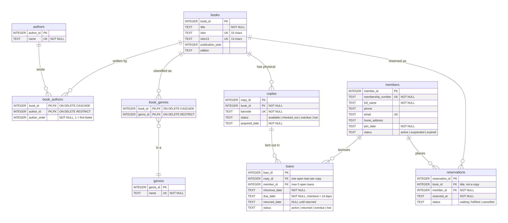

# Library Database Summary

My goal was a system that tells me what books I have, how many copies are available, who has borrowed them, and when they are due back, while treating members fairly. `library.db` (SQLite) does this with nine tables. `schema.sql` builds it, `load_data.sql` loads 25 books from the goodbooks-10k `books.csv` plus sample members and loans, and `queries.sql` produces the reports.

## 1. Table Overview

| Table | One row represents | Why it exists |
|---|---|---|
| `books` | One title/edition: title, ISBN, ISBN-13, year, edition | What I see when I "pull up a book"; stored once, however many copies I own |
| `authors` | One person | Some books have two or three authors; each is stored once and searchable |
| `book_authors` | One book–author pairing, in listed order | Links books to all of their authors |
| `genres` | One genre | A fixed list, so a genre is always spelled the same way |
| `book_genres` | One book–genre pairing | A book can be science fiction *and* adventure |
| `copies` | One physical item, with its barcode and status | What I actually scan, lend, get back or lose |
| `members` | One cardholder: name, phone, email, address, join date, unique membership ID, status | Who may borrow; `active`, `suspended` or `expired` decides whether they can |
| `loans` | One copy borrowed once: checkout date, due date (+14 days), return date, status | Four books checked out = four loans, because they may come back on different days |
| `reservations` | One member waiting for one title | Members can reserve books that are already out |

## 2. Relationships

**One-to-many.** The "many" side stores a foreign key (FK) pointing to the "one" side's primary key:
- **`books → copies`:** each copy's `book_id` names its title.
- **`copies → loans`:** each loan's `copy_id` names the exact item scanned.
- **`members → loans`:** each loan's `member_id` names the card that was scanned.
- **`members → reservations` and `books → reservations`:** a hold records who is waiting and for which title.

**Many-to-many.** A book has many authors and an author writes many books, so neither table can hold the other's ID. Junction tables store one row per pairing: `book_authors (book_id FK, author_id FK)` and `book_genres (book_id FK, genre_id FK)`. The two FKs together form the primary key, so a pairing can't be entered twice.

**Delete rules.** FKs also control deletion. Junction rows go with their book (`CASCADE`). A book that has copies, or a copy or member that has loans, can't be deleted (`RESTRICT`). That keeps "a record of what happened," as my notes require for lost books.

## 3. Key Design Decision: Books vs. Copies

In my notes, three copies of *Dune* are "one book record for that edition, but three separate copies." The schema follows that exactly: one `books` row and three `copies` rows, each with its own barcode and status (`available`, `checked_out`, `overdue`, `lost`).

- **No duplication.** Title, ISBN, year and authors are stored once. If every physical copy had its own full record, a typo would have to be fixed three times, and the copies could drift apart.
- **It matches real circulation.** I scan a *copy's* barcode, so loans point to `copy_id`. That gives me my rules directly:
  - Two people can borrow *Dune* at once if I own two copies.
  - A partial unique index (`one_open_loan_per_copy`) makes it impossible to lend the *same* copy twice.
  - A lost copy keeps its row with status `lost`, stays in the history, and is never shown as available.
- **Reservations stay at the title level.** A member waits for *Dune*, not a particular barcode, so any returned copy can fill the hold.

## 4. Critique and Edge Cases

**The CSV needed parsing, not a straight import.**
- **Multiple authors in one field.** Values such as `"J.K. Rowling, Mary GrandPré"` were split on commas into separate `authors` rows, giving 23 authors and 37 links for 25 books. Two problems remain:
  - Splitting on commas would break a name like "Martin Luther King, Jr."
  - The CSV doesn't label roles, so an illustrator (GrandPré), a narrator (Rufus Beck) and an afterword writer (Erich Fromm) are all stored as authors.
- **Corrupted ISBNs.**
  - `isbn13` had been saved as numbers in scientific notation (`9.78043902348e+12`), which keeps 12 significant digits, so the 13th digit was lost.
  - `isbn` had lost its leading zeros.
  - The fix: store ISBNs as `TEXT`, pad the ISBN-10 back to 10 characters, and rebuild each ISBN-13 using the check-digit formula. This is the Module 1 lesson again: an identifier that looks like a number gets damaged when software treats it as one.

**Some rules need triggers.** A `CHECK` constraint in SQLite only sees the row being written; it can't count other rows. My five-book limit means counting a member's open loans, so it's enforced by a `BEFORE INSERT` trigger on `loans`. The same trigger blocks borrowing by suspended or expired members and lending a lost copy. Other triggers keep each copy's status in step with its loan.

**Where the database doesn't yet match my notes:**
- **Overdue isn't automatic.** SQLite can't act on a timer, so a loan stays `active` past its due date until it is updated. The `loans_past_due` view lists these loans so they can be marked.
- **Suspension isn't automatic.** My plan to stop someone borrowing until an overdue book comes back is not a rule yet; a member must be set to `suspended` by hand.
- **Not yet modeled:**
  - reminders and notifying the next person waiting for a reservation;
  - the reservation queue order;
  - replacement or payment for lost books;
  - a `damaged` copy status.
- **Foreign keys must be switched on.** SQLite only enforces them after `PRAGMA foreign_keys = ON` in each connection.
